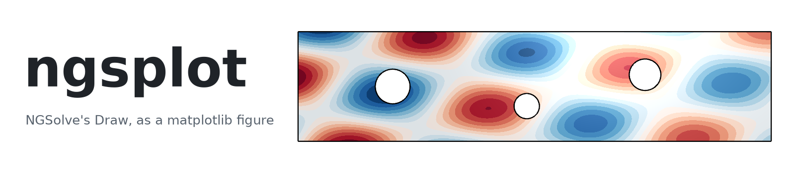
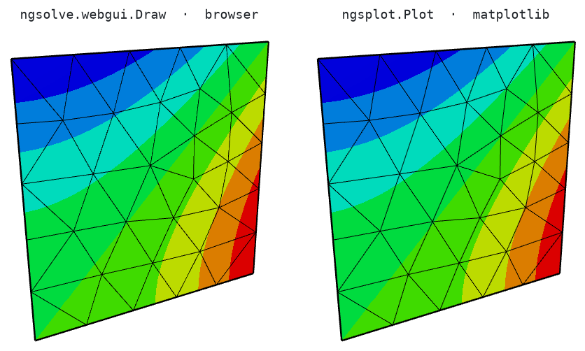
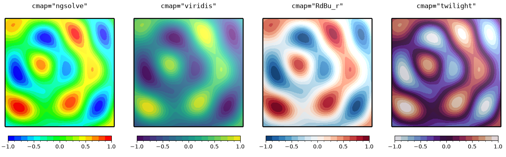
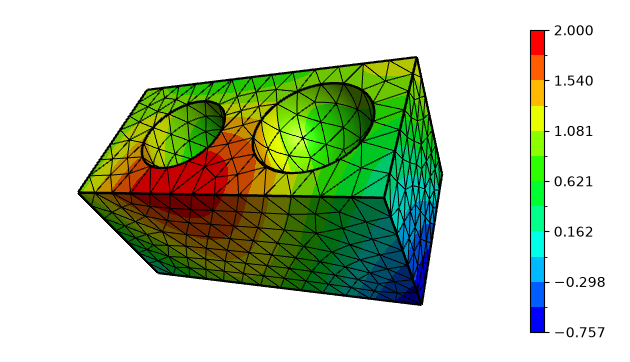
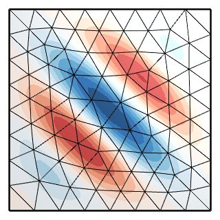
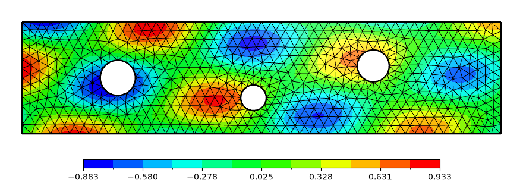

<p align="center">
  <picture>
    <source media="(prefers-color-scheme: dark)" srcset="docs/images/banner-dark.png">
    
  </picture>
</p>

<p align="center">
  <a href="https://github.com/CAarset/ngsplot/actions/workflows/tests.yml"></a>
  
  
  
  <a href="LICENSE"></a>
</p>

**ngsplot** paints [NGSolve](https://ngsolve.org) finite element fields the way `ngsolve.webgui.Draw`
does — the same subdivision, colour bands, lighting, antialiased lines and camera — into an
ordinary matplotlib image. Subplots, colourbars, `savefig` and animations work as they always do,
and nothing needs a browser.

<p align="center">
  
  <br>
  <sub>One payload, two renderers. Away from the one-pixel mesh lines, 99.7–99.98% of pixels are
  byte-identical to the browser's screenshot; the test suite checks every recorded scene against
  its screenshot.</sub>
</p>

## Installation

```bash
pip install "ngsplot[ngsolve] @ git+https://github.com/CAarset/ngsplot"
```

ngsplot itself needs only NumPy and matplotlib; NGSolve is what turns a `GridFunction` into
something to paint.

## Quick start

```python
import ngsolve as ngs
from ngsplot import Plot, pyplot

mesh = ngs.Mesh(ngs.unit_square.GenerateMesh(maxh=0.1))
gfu = ngs.GridFunction(ngs.H1(mesh, order=3))
gfu.Set(ngs.sin(4 * ngs.x) * ngs.cos(5 * ngs.y))

Plot(gfu, colorbar=True)            # what Draw(gfu) shows, as a matplotlib AxesImage
pyplot.savefig("gfu.png")           # the rendered pixels, byte for byte
```

`Plot` accepts what `Draw` accepts, and the controls of the viewer's panel as keywords:

```python
Plot(gfu, ax=ax, cmap="viridis", ncolors=16, vmin=-1, vmax=1)   # into your own subplots
Plot(gfu, elev=30, azim=-60, wireframe=False, deformation=0.2)   # camera and display
Plot(gfc, eval="imag")                                           # which part of a value
Plot(gfu, fit="box", width=900, height=None)                     # a long domain, framed tightly
```

## Features

- **Faithful.** A NumPy port of the webgui renderer: Bézier subdivision, banded colour map, Phong
  lighting, 4× MSAA lines and the perspective camera, checked pixel by pixel against screenshots.
- **matplotlib all the way.** A picture is one `AxesImage`: `ax=`, gridspec, titles, `colorbar`,
  `savefig` and `FuncAnimation` need nothing new.
- **Everything `Draw` draws.** Meshes, `GridFunction`s and `CoefficientFunction`s on 1D, 2D and 3D
  meshes, vector and complex fields, `L2`, `NumberSpace`.
- **Layout you control.** `fit="box"` frames long domains, a wide picture gets its colourbar
  underneath, and `ngsplot.frame` returns the camera and canvas size before anything is painted.
- **Made for live views.** `ngsplot.render_data` builds the payload without a widget — no comm, no
  notebook bloat, any thread — and painting is plain NumPy: about 0.15 s for a panel of a
  1500-element cubic field.

## Gallery

<table>
  <tr>
    <td colspan="2" align="center">
      
      <br><sub>Any matplotlib colour map, cut into the viewer's bands</sub>
    </td>
  </tr>
  <tr>
    <td align="center" width="62%">
      
      <br><sub>Solids with curved elements, from any angle</sub>
    </td>
    <td align="center">
      
      <br><sub>One <code>Plot</code> per frame is an animation</sub>
    </td>
  </tr>
  <tr>
    <td colspan="2" align="center">
      
      <br><sub><code>fit="box"</code> frames a long domain, with its colourbar underneath</sub>
    </td>
  </tr>
</table>

The [demo notebook](examples/ngsplot.ipynb) runs through 1D, 2D and 3D spaces, every keyword, and
an animation embedded in the notebook itself.

## How it works

`ngsplot.render_data` asks NGSolve for the payload `Draw` would send to the browser.
`ngsplot.scene.paint` rasterises it in NumPy, the way the viewer's shaders do, and `Plot` lays the
pixels on a matplotlib axis. Two things are left out on purpose: the viewer's control panel, and
colour along a 1D mesh, which the viewer draws as a plain black line and so does ngsplot.

## Development

```bash
git clone https://github.com/CAarset/ngsplot && cd ngsplot
pip install -e ".[test]"
pytest
```

The tests compare against screenshots of the real viewer in `tests/gt/`. `tools/capture_gt.py`
and `tools/capture_dims.py` record them again with headless Chromium (`pip install -e ".[gt]"`),
and `tools/readme_images.py` redraws the pictures on this page.

## Licence

MIT; see [LICENSE](LICENSE). ngsplot is an independent reimplementation and is not affiliated
with the NGSolve project. NGSolve and Netgen are licensed under the LGPL-2.1.
